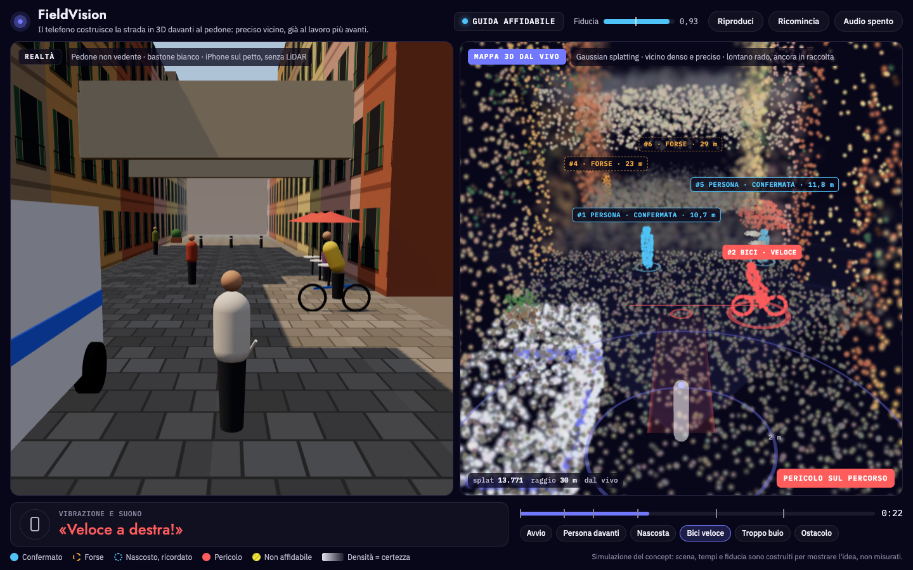

# FieldVision Splat Guide
Concept visual for **The Big Hack 2026** (Codemotion, Napoli), challenge 03 **"FieldVision – When Sight Is Not Enough"** by Mare Group.

**IT.** A sinistra la strada vera: un pedone non vedente con bastone bianco e iPhone sul petto, senza LiDAR. A destra la mappa 3D che il telefono costruisce mentre cammina, disegnata come gaussian splat: densa e precisa vicino, rada e ancora in raccolta più avanti. In italiano o in inglese, con una voce naturale, un tic ogni 2 secondi quando la guida vede bene, e suoni di avviso.

**EN.** Left: the real street, with a blind pedestrian carrying a white cane and an iPhone on the chest (no LiDAR). Right: the 3D map the phone builds while they walk, drawn as Gaussian splats: dense and accurate up close, sparse and still being gathered further ahead. In Italian or English, with a natural voice, a tick every 2 seconds while the guide can see, and warning sounds.

 

## Run it
Open `index.html` in Chrome or Safari. It needs internet, because three.js loads from a CDN. It opens in your browser's language, Italian or English; switch with **IT / EN** at the top, and the page remembers your choice. Click **Start with Sound** (**Avvia con audio**) and use headphones. Press Space to play or pause. The timeline is split into checkpoints, one per case (the person ahead, the hidden person, the bike, the dark passage, the obstacle): click or drag it to jump, or use the arrow keys to go from one checkpoint to the next. The page follows your system's light or dark appearance.

 

## The scene (61 s)
| Time | What happens | Voice (IT) | Voice (EN) | Sound / vibration |
|---|---|---|---|---|
| 0:00 | Start | «Guida attiva. Vedo solo davanti.» | “Guide on. I can only see ahead.” | tick every 2 s |
| 0:09 | A person stands in the path | «Persona davanti» | “Person ahead” | one knock |
| 0:14 | They walk behind a parked van; the map keeps a ghost of them | «Persona nascosta, a sinistra» | “Person hidden, on the left” | flutter |
| 0:17 | Back in view, same ID | «Persona riapparsa, a sinistra» | “Person back in view, on the left” | one knock |
| 0:22 | A bike shoots out of a side street; the walker stops | «Veloce a destra!» | “Fast on the right!” | two strong pulses |
| 0:36 | Dark covered passage: the map freezes | «Guida non affidabile: troppo buio» | “Guide unreliable: too dark” | long–long, repeating every 4 s |
| 0:46 | Out in the light | «Guida di nuovo attiva» | “Guide on again” | two rising knocks |
| 0:48 | A bollard in the path | «Ostacolo davanti» | “Obstacle ahead” | beeps faster as it gets closer |

 

## Files
- `index.html`: the built page.
- `src/sim-core.js`: the scene logic (plain JS, no DOM): paths, field of view, occlusion by the van, the trust check, sound events, and the words the scene owns, in Italian and English: every spoken line in `VOICE`, the object names and the timeline checkpoints.
- `src/text.js`: every piece of interface text in Italian and English (`TEXT`), including the sound cues and map labels, and the language choice. It runs first, so the page never flashes the wrong language.
- `src/app.js`: three.js rendering of both views, the Web Audio sounds, the voice, the subtitles, and switching language mid-scene.
- `src/shell.html`: markup and styles: SF Pro, loaded from the system and never embedded, on Apple's text styles, Apple's light and dark system colors as CSS tokens, Liquid Glass surfaces. The page follows the system appearance; the two 3D views always stay dark, and the scenes read their colors from them.
- `src/voice/`: every line in `VOICE` recorded as an MP3, in `it/` and `en/`, with `lines.json` mapping each line to its file. The page plays these instead of the browser's speech, which it keeps only as a fallback.
- `voice.py`: records the lines in `src/voice/` with Microsoft's neural voices, Isabella for Italian and Ava for English, through edge-tts. After you change a line, run `pip install edge-tts`, then `python3 voice.py`, then `python3 build.py`.
- `build.py`: rebuilds `index.html` and `dist/artifact.html` (the claude.ai version) after you edit `src/`, with the voice clips embedded.
- `test/test-sim.js`: `node test/test-sim.js` prints the event timeline, with each line in both languages.

 

## Honest note
This is a simulated scene, not measurements. Real-time Gaussian splatting on a phone can't be built by the end of the hackathon. The buildable stand-in is ARKit's 3D feature points (any iPhone, no LiDAR) drawn as splats, plus our detections placed in that 3D space.
